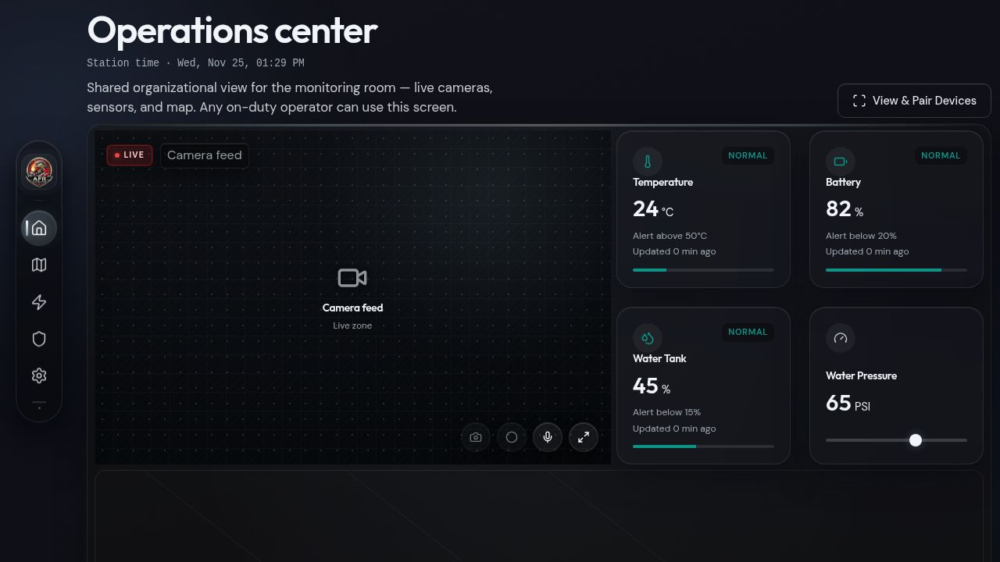
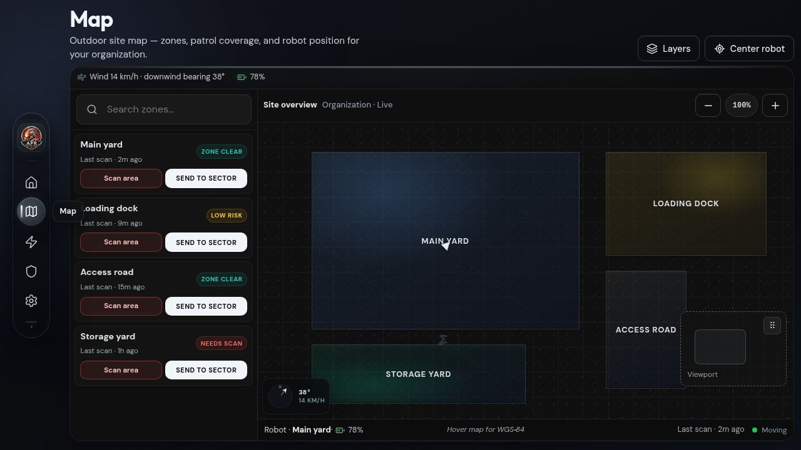
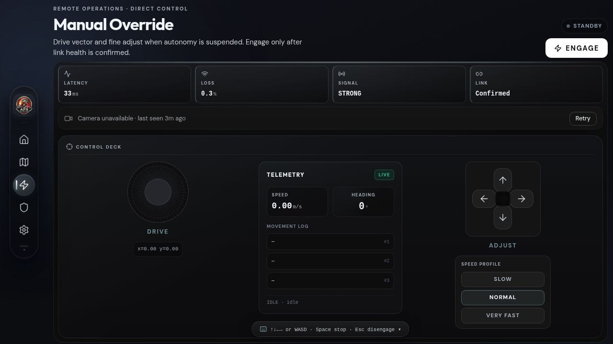
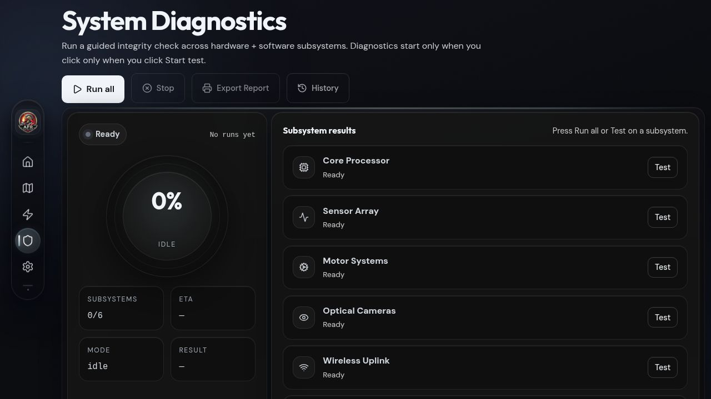

# Augustus OS: field operations dashboard

A React web app for monitoring and driving field robots: live site map, sensor and camera panels, manual override and a guided system check, behind a secure sign-in. English and Arabic (RTL), light and dark themes.

**Live site:** https://wilo101.github.io/GraduationProject/

**Tech:** React 19, Vite 7, React Router 7, Framer Motion, Supabase auth (email, Google, phone OTP), i18next (en, ar), Playwright end-to-end tests, installable PWA.

## Screens
- **Operations center:** live camera feed panel and sensor cards for temperature, battery, water tank and water pressure, with a device pairing flow.
- **Map:** site zones, patrol coverage and robot position, zone search, scan area and send-to-sector actions, wind and battery status.
- **Manual override:** drive joystick with keyboard control, speed profiles, and live telemetry for latency, packet loss and signal.
- **System diagnostics:** guided integrity check across six subsystems with Run all, per-subsystem tests, report export and run history.
- **Deploy robot, account and settings:** security, notifications and country settings, plus an onboarding tour for first-time users.

## Structure
```
src/pages/       login, dashboard, map, deploy robot, diagnostics, automation, account, onboarding
src/components/  sidebar, camera feed, map panels, status cards, pairing modal, onboarding tour
src/context/     auth context (Supabase session)
src/lib/         Supabase client, auth error mapping, enter transition
src/locales/     en.json and ar.json
e2e/             Playwright specs: email login, registration, phone OTP, Google OAuth, authenticated flows
```

## Run
```bash
pnpm install
cp .env.example .env     # add your Supabase URL and publishable key
pnpm dev
pnpm build               # production build
pnpm test:e2e:install && pnpm test:e2e
```

## Status
- The app is running at the live site above. Sign-in needs a Supabase project configured in `.env`.

## Screenshots




